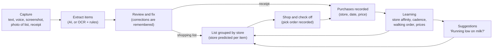
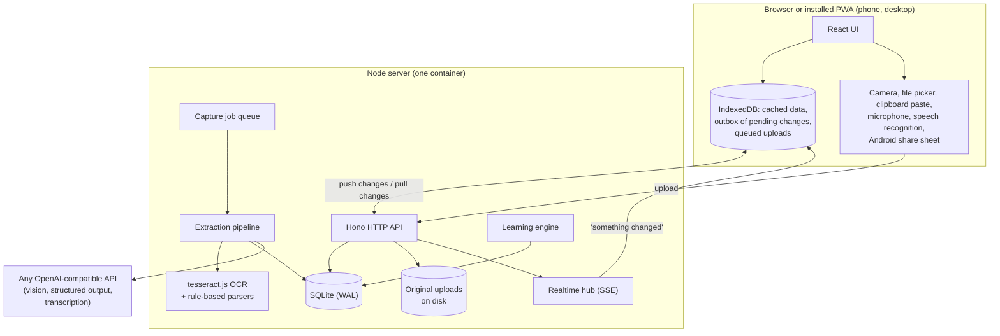

# Aisle: design

Aisle is a shopping list that you can feed with anything (typed text, a voice note, a screenshot, a photo of a handwritten list, a receipt), that files every item under the store you usually buy it from, and that gets better at this the more you shop.

This document explains what the app does, how it is put together, and why. Section 9 is the step-by-step build plan, including what is built in this first version and what comes next.

## 1. Goals

1. **Capture in any form.** Typed or pasted text, live dictation, recorded voice notes, screenshots (a notes app, a text message from your partner, a recipe), photos of handwritten lists, photos or screenshots of receipts, and pasted order-confirmation emails.
2. **Group by store.** The list is shown as one section per store ("Costco: paper towels, olive oil. Trader Joe's: bananas, oat milk"), and each item is assigned to a store automatically.
3. **Learn from what you actually do.** Which store you buy each item at, how often you buy it, what it costs where, and the order you pick things up in each store. The app uses this to file new items, sort each store's section in walking order, and suggest things you are about to run out of.
4. **Sync across devices and people.** Phone, laptop, and everyone in the household see the same list within a second, and the list keeps working with no signal inside the store.

Not in scope for the first version: ordering or delivery, meal planning, comparing prices against retailers' online catalogs, and app-store native apps (the web app installs to the home screen; native wrappers are a later step).

## 2. The core loop



Every kind of input ends up as the same thing: a reviewed set of items. A list adds items to the shopping list. A receipt records purchases and ticks off anything on the list that you just bought. Purchases, check-offs, and your corrections are the signals the app learns from.

## 3. Architecture



The reasoning behind each choice:

- **An installable web app (PWA) rather than native apps, for now.** One codebase covers phone and desktop. Camera capture, microphone recording, offline use, home-screen install, and receiving shared screenshots from the Android share sheet all work from the web. Wrapping it with Capacitor later gives app-store builds and an iOS share extension without rewriting the UI.
- **One small server with SQLite.** A household's shopping data is small (thousands of rows a year). SQLite in WAL mode on a persistent disk is fast, needs no separate database service, and backs up as a single file (Litestream can stream it to S3). All queries are plain SQL in one data layer, so moving to Postgres later is mechanical.
- **Hono** for the HTTP API. It is small, built on standard `Request`/`Response` objects, and routes can be tested without opening a network port.
- **AI behind one interface.** Extraction talks to any OpenAI-compatible endpoint: OpenAI itself, OpenRouter, or a local Ollama vision model if you want images to stay on your own machine. With no key configured, the app still works using on-device OCR and rule-based parsing. That path is good on screenshots and printed receipts and poor on handwriting, and it cannot transcribe uploaded voice notes (live dictation still works because the browser does the speech recognition).
- **Learning is transparent statistics, not a trained model.** Every prediction comes with a reason you can read ("usually from Costco, 6 of 7 times"), it works from the first receipt with no training step, and it adapts when your habits change. Section 6 has the details.

## 4. Data model

Everything belongs to a **household**. A user belongs to one household; sharing the list with someone means they join your household with its invite code.

| Table | What it holds | Notes |
| --- | --- | --- |
| `households` | name, invite code, `rev` | `rev` is a counter bumped on every write; it drives sync |
| `users`, `sessions` | email, name, scrypt password hash; hashed session tokens | |
| `stores` | name, color, sort order | synced to clients |
| `store_aliases` | normalized alias, store | learned from receipts ("TRADER JOE'S #552" means Trader Joe's) |
| `products` | canonical item ("Oat milk"), normalized key, category, predicted store with confidence and reason, purchase count | synced to clients so new items can be filed offline |
| `product_aliases` | normalized alias, product | learned from receipts and corrections ("ORG BNNA" means Bananas) |
| `list_items` | the shopping list: product, display name, quantity, unit, note, store, why it is at that store, checked time and by whom | synced; soft-deleted rows become tombstones |
| `captures` | one row per thing you captured: media type, hint (list, receipt, or auto), status, original file key, transcript, extraction result, error | synced so every device sees the review queue |
| `purchases` | product, store, date, quantity, price, source (receipt or check-off) | the main learning signal; not synced, summarized by the insights API |
| `store_choices` | explicit "this item belongs at that store" decisions | recorded when you move an item to another store |
| `applied_ops` | IDs of change operations already applied | makes retries safe |

Every synced table has a `rev` column (the household's counter at the time of the last write) and a `deleted_at` column.

## 5. Ingestion: from anything to items

### 5.1 Input types

| Input | How it gets in | With an AI provider | Without one |
| --- | --- | --- | --- |
| Typed or pasted text | quick-add box, paste box, share sheet | language model turns free text into items ("grab two avocados and oat milk") | rule-based parser: splits lines, commas, and "and"; reads quantities and units; strips filler words; understands store headings |
| Live dictation | browser speech recognition, each pause becomes a new line | same as text | same as text (works in Chrome, Edge, and Safari) |
| Recorded voice note | microphone recording or uploaded audio file | transcription, then the text path | not available; the app says so and suggests dictation |
| Screenshot or photo of a list | camera, file picker, drag and drop, clipboard paste, share sheet | vision model, including handwriting | OCR, then the rule-based parser (good on screenshots, poor on handwriting) |
| Receipt (photo, screenshot, or pasted e-receipt) | same as above, with an optional "receipt" hint | vision model returns store, date, total, and line items with abbreviations expanded ("ORG BNNA" becomes "Organic bananas") | OCR, then a receipt-line parser and a dictionary of chain names |

### 5.2 Pipeline

1. The browser shrinks large photos before uploading (and fixes their rotation), so uploads are fast on a weak signal. If there is no connection, the capture waits in IndexedDB and uploads later.
2. The server stores the original file, creates a `captures` row with status `pending`, and puts it on the job queue. Pending jobs are picked up again after a restart.
3. The pipeline turns the input into an **extraction**, which has the same shape whichever engine produced it:

   ```json
   {
     "kind": "list | receipt | other",
     "store": "Trader Joe's",
     "purchasedAt": "2026-10-24",
     "total": 42.17,
     "items": [
       { "name": "Organic bananas", "rawText": "ORG BNNA", "quantity": 1, "unit": "bunch",
         "price": 1.99, "category": "Produce", "storeHint": null }
     ]
   }
   ```

   With an AI provider, images go to a vision model with this JSON schema enforced through structured output, audio goes to the transcription endpoint first, and the prompt includes your existing store and product names so the model reuses them. Without a provider, images go through OCR and the text goes through the rule-based parsers.
4. Each extracted item is **resolved** against what the app already knows: matched to an existing product (by exact key, learned alias, or close fuzzy match), given a category, and given a predicted store.
5. The capture becomes `ready`, and every device shows it in the review queue.
6. You review it. You can rename items, change quantities, switch an item's store, untick lines you do not want, and switch between "shopping list" and "receipt". Applying it adds list items, or for a receipt records purchases and checks off matching list items. Your edits are learned: if a receipt said "KS PPR TWL" and you renamed it "Paper towels", the next receipt with that line is matched automatically.

The review step stays because extraction from photos is never perfect, and because corrections are the cheapest way for the app to learn your vocabulary.

## 6. Learning

All of this runs on the server from the `purchases` and `store_choices` tables, and the results are synced or served to clients.

### 6.1 Recognizing the same item

Names are normalized into a key: lowercased, accents and punctuation removed, plurals made singular, filler words dropped, words sorted ("Milk 2%" and "2% milk" share a key). An item matches an existing product if its key matches the product or one of its learned aliases, or if the names are nearly identical by character-trigram similarity (this catches typos and OCR noise). Similar-but-different products such as "almond milk" and "milk" deliberately do not match.

### 6.2 Which store an item belongs to

For each product, every signal adds a weight to a store, and older signals count less (the weight halves every 120 days, so the app follows you when you change stores):

| Signal | Weight |
| --- | --- |
| Bought it there, according to a receipt | 1.0 |
| Checked it off while it was filed under that store | 0.6 (lower, because the store was the app's own guess) |
| You moved it to that store | 2.0 |

The predicted store is the one with the highest total, and the confidence is that store's share of the total. One rule sits on top: **your latest explicit choice wins** until a later receipt shows you bought the item somewhere else. If you move milk to Trader Joe's, milk goes to Trader Joe's next time too, even if it used to come from Costco.

For an item the app has never seen, it uses the category ("most of your produce comes from Trader Joe's"). If there is only one store, everything goes there. Otherwise the item waits in "Unsorted" until you file it, which teaches the app.

### 6.3 When you will need it again

For a product with at least three purchase days, the app takes the median gap between purchases (the median ignores the odd unusual week) and predicts the next purchase at the last purchase plus that gap. When that date is close or past, and the item is not already on the list, it appears under "Running low?" with its reason ("about every 7 days; last bought 8 days ago") and one tap adds it to the right store.

### 6.4 Walking order inside a store

Check-offs at the same store less than 90 minutes apart form a trip. In each trip, items get a position from 0 (first picked up) to 1 (last). Averaging those positions per product, and per category, gives each store its own order, so the produce section of the list comes first at the store where you start in produce. Before there is any history, sections use a sensible default category order.

### 6.5 Prices

Receipt lines give a price per product per store. Insights show the average and last price at each store, and point out when an item is consistently cheaper elsewhere.

## 7. Sync and offline

The list must work in a store with no signal, and two people editing at once must not lose each other's changes.

- **Changes are operations.** Every edit is an operation with a client-generated ID (add item, check item, move item to store, and so on). The client applies it to its local copy at once, saves it to an outbox in IndexedDB, and sends the outbox to `POST /api/ops` when it can. The server records applied operation IDs, so sending the same operation twice is harmless.
- **Pulling is incremental.** Each household has a `rev` counter that increases on every write, and every changed row is stamped with it. `GET /api/sync?since=N` returns everything changed after `N`, including deletions. The client keeps the server's copy and replays its unsent operations on top, so local changes never flicker away.
- **Realtime.** Each device holds a server-sent events connection. After any write the server sends the new `rev`, and other devices pull straight away. Devices also pull when they come back online, when the app is reopened, and every minute as a fallback.
- **Conflicts.** The last operation to reach the server wins, field by field for edits. For a shopping list this matches what people expect. Check-offs keep the time they happened on the device, so offline check-offs still record the right walking order.

## 8. Security and privacy

- Passwords are hashed with scrypt. Sessions are random tokens in HTTP-only, SameSite cookies, and only a hash of each token is stored. Login attempts are rate limited.
- Every request is scoped to the user's household, and state-changing requests must carry a custom header, which a cross-site form cannot send.
- Uploaded originals are stored on the server's disk and are only served to members of the household. Uploads are size-limited and restricted to image, audio, and text types.
- When an AI provider is configured, images, audio, and text you capture are sent to it. To keep them on your own hardware, point the provider at a local Ollama vision model, or run without a provider.

## 9. Build plan, step by step

Each step is a separate commit, so the history can be followed in order.

| Step | What it delivers | Status |
| --- | --- | --- |
| 1. Design | This document | Done |
| 2. Scaffold | One package: Vite + React + Tailwind PWA, Hono server, SQLite migrations, Vitest | Done |
| 3. Domain logic | Shared parsers (list text, receipts), name normalization, categories, fuzzy matching, store-name canonicalization, with unit tests | Planned |
| 4. Accounts and sync | Sign-up, login, households and invites, stores, list items, operation push and incremental pull, realtime events | Planned |
| 5. Learning | Store prediction, purchase cadence, walking order, price stats, aliases, insights API | Planned |
| 6. Ingestion | Uploads, job queue, OpenAI-compatible provider, OCR fallback, review and apply | Planned |
| 7. Web app | List grouped by store, quick add with autocomplete, capture screen (camera, upload, paste, record, dictate), review screen, insights, stores and household settings, offline outbox, share target | Planned |
| 8. Deploy | Dockerfile and Fly.io config with a persistent volume | Planned |

Next steps, roughly in order of value:

1. **Run it with a real AI key on your own receipts and lists**, then tune the prompt and the matching thresholds against what you see.
2. **Native wrapper** with Capacitor for an iOS share extension (sharing screenshots straight from Photos) and app-store distribution.
3. **Product merge and rename tools** for cleaning up duplicates the matcher missed.
4. **Smarter suggestions**: quantity-aware cadence (buying two means a longer gap), "usually bought together", and price alerts.
5. **Media retention settings**, such as deleting original photos after they are applied.
6. **Postgres and object storage** (S3 or R2) if it ever needs to serve many households.
7. **Local transcription** with whisper.cpp, so voice notes work without an AI provider.
